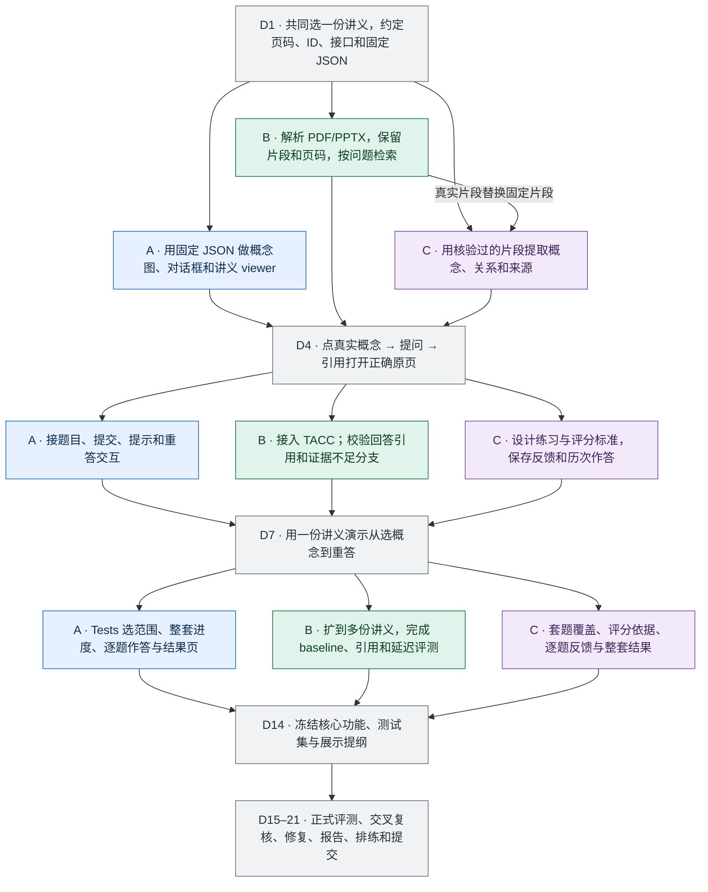

# StudyGraph 第一次小组会

第一周，我们想让同学拿一份真实讲义走完这样一遍：点一个没看懂的概念，问一句“这是什么意思？”，从回答点回讲义原页，再做一道相关的题。答错了，可以看提示，再试一次。

现在已经有一个能打开的[演示版](../README.md)，用的是我们自己写的两页 Roofline 讲义。里面的回答和题目是事先准备好的。我们也已经在学校的 TACC 上跑通过模型，下一步要把它接进这个演示版，让回答真正来自选定的讲义。

## 两个页面分别完成什么

**Learning** 从一个学生想弄懂的问题开始。学生在概念图上选中 Roofline，问“为什么这里受带宽限制？”，读解释、点引用回到原页。需要检查理解时，可以在这段对话里要一道练习、看提示并重答。

**Tests** 从一套测验开始。学生选择要复习的讲义和概念，系统一次生成覆盖这些概念的一组题。例如围绕 Roofline 生成 5 题，分别考计算强度、带宽上限、峰值算力和瓶颈判断。进入测验后显示“第 1 题 / 共 5 题”；学生逐题作答、提交、查看提示或讨论思路，最后查看整套完成情况、逐题反馈和讲义出处。5 题是提案图 2 的示例题量。

两页共有讲义查看器、引用和模型服务。Learning 保存对话上下文，Tests 保存一套题的题序、每题作答记录和整套进度。D7 先验收 Learning；第二周单独验收 Tests，从生成套题一直走到完成测验。

## 团队分工

先按下面三块认领。三周暂时按每人每周 16 小时来算，包括写代码、准备数据、检查结果和准备展示。第一周结束时一起看看谁最忙，把具体任务分出去。

**A 负责产品功能设计与前端交互。** A 梳理学生从选择概念、提问到查看原文和练习的完整流程，和 B、C 约定每一步需要的数据。例如，学生在概念图中选择“带宽上限”后，对话应自动关联这个概念；回答中的引用应能打开讲义对应页。A 也负责模型等待、检索无结果和请求失败时的页面反馈。第一周先让大家能从一条回答点到正确的讲义页。后面补单独的练习页和学习记录，最后负责试用流程、现场演示和备用录像。

**B 负责讲义检索、模型接入与响应速度。** B 先把 PDF 或课件按页读出来，每段文字都记住出自哪一页。学生提问时，先找相关原文，再把问题和原文一起发给 TACC 上的模型。第一周先拿一个真实问题跑通，让大家看到回答、出处和用了多久。之后分别测“找原文”和“等模型回答”各花多少时间，挑最慢的一步改，再用同一批问题比较：快了多少？引用还准吗？最后由 B 展示系统怎么运行、哪里还有待改进。

**C 负责课程数据、练习设计与效果评测。** C 先找一份大家可以共享的课程讲义，从里面挑两个相关概念，记下出处，做一道题，再写一个有代表性的错答和评分理由。这些材料既能给 A 做页面，也能给 B 核对模型回答。之后 C 把材料整理成概念图和练习，负责判断学生错在哪里、该给什么提示，以及怎么保存每次作答。收集来的题目和我们自己编的题目要标清楚。最后由 C 汇总结果，挑一个做得不好的例子，讲清楚问题出在哪儿。

评测由三人共同承担。A 负责约 8 个学生操作任务，比如连续追问后还能不能回到正确页；B 负责约 20 个讲义问题，核对答案、引用和耗时；C 牵头整理约 20 个概念、15 条关系、10 道练习和 20 份典型错答。三人交换检查。提前留出一部分题，最后统一测，开发时不用它们调答案。如果整理和核对讲义太费时间，A、B 各接一份帮忙看。

## 并行开发与接口协作

B 的三周任务、交接时间和评测方法见[检索与模型工作计划](retrieval-model-plan.md)。

拿演示里的“带宽上限”举例。**B** 找到讲义第 2 页那段公式，把原文、讲义名和页码交给 **C**。**C** 把“带宽上限”这个概念连到这段原文。**A** 拿到这份数据，就能把概念画出来，也知道点引用时该翻到第几页。第一天先一起写好这一条样例，三人即可基于相同的数据格式并行开发。

| 学生在做什么 | 三个人怎么配合 | 要用 AI 吗？ |
|---|---|---|
| 看概念图、翻讲义 | C 给出概念之间的关系，B 给出原文和页码，A 显示出来 | 点开、翻页都直接读已有内容。整理材料时可以让模型先找概念，再由人核对 |
| 提问或追问 | A 把问题、正在看的概念和这段对话的编号交给 B。B 返回回答和出处，A 显示。讲义里找不到依据时，也告诉学生 | 正式版需要，由 B 调 TACC |
| 要一道练习题 | A 显示题目，C 准备题目和评分依据 | 题库里已有的题直接用；临时出新题时，C 可以用 B 接好的模型 |
| 答错后再试一次 | C 给出反馈，A 显示提示并允许重答。同一题的两次答案分开保存 | 数值题可以直接算。开放题需要分析理由时，再调用模型 |

具体的接口名、字段和数据样例放在[接口约定](document-api.md)。想看全貌，可以打开[项目流程图](system-flow.md)。

## 三周分工图



## 会议议程与待定事项

| 时间 | 一起做的事 |
|---|---|
| 前 5 分钟 | 试一下现有演示：选“带宽上限”，问“解释这个概念”，点开第 2 页。练习先答 50，看提示，再答 100。 |
| 第 5–10 分钟 | 选第一份真实讲义，当场找出两个概念、对应页码和一个值得问的问题。 |
| 第 10–20 分钟 | 认领 A、B、C。每个人说清楚自己先做哪件事、需要谁给什么、做完怎么让另外两个人看到。 |
| 最后 5 分钟 | 填好下面的表，约好两次碰头时间。 |

| 待确认事项 | 会上填写 |
|---|---|
| A / B / C 分别是谁，各自先做什么 | |
| 用哪份讲义，先做哪两个概念，在哪几页 | |
| 哪些题先留着，最后再测 | |
| 第 4 天什么时候碰头？一起试“点概念 → 提问 → 打开正确原页” | |
| 第 7 天什么时候演示？在上面的基础上，加上“做题 → 看提示 → 重答” | |
| 需要协作的任务、负责人和交付时间 | |

## 切换 TACC / DeepSeek 运行评测

以下是当前代码的运行方式，历史报告中的模型名称和成绩保持原样；切换模型后应保存到新的结果目录并重新评分。[完整配置、参数和运行说明](../evaluation/runners/README.md)。命令均从仓库根目录执行。

先启动 TACC 模型及 SSH 隧道，然后在运行评测脚本的终端设置地址并检查接口：

```bash
export QWEN_BASE_URL=http://127.0.0.1:18024/v1

curl --noproxy '*' -fsS --max-time 8 \
  http://127.0.0.1:18024/v1/models
```

直接调用 TACC 的评测脚本不需要 DeepSeek API key。改用 DeepSeek 时，需要在当前进程配置 `DEEPSEEK_API_KEY`。如果密钥已保存在项目 `.env` 中，可以加载：

```bash
set -a
source .env
set +a
```

按评测角色选择以下命令。所有命令均使用项目的 `.venv/bin/python`，输出路径需尚未存在。

**1. TACC 出题，并使用 TACC 评分**

```bash
.venv/bin/python -m evaluation.runners.quiz \
  --provider tacc \
  --output-dir evaluation/results/quiz-tacc-new
```

如果希望由 TACC 出题、DeepSeek 担任裁判：

```bash
.venv/bin/python -m evaluation.runners.quiz \
  --provider tacc \
  --judge-provider deepseek \
  --output-dir evaluation/results/quiz-tacc-deepseek-new
```

**2. TACC 批改学生答案**

```bash
.venv/bin/python -m evaluation.runners.grading_feedback \
  --provider tacc \
  --workers 1 \
  --output-dir evaluation/results/grading-tacc-new
```

**3. TACC 对已有概念图进行语义评分**

以下以 Lecture 1 的现有预测为例，只重新评分，不重新生成概念图：

```bash
.venv/bin/python -m evaluation.runners.knowledge score \
  --reference evaluation/01_knowledge/v0.5-en/lecture1.json \
  --prediction evaluation/results/v0.5-en-20261119/l1/prediction.json \
  --judge tacc \
  --output evaluation/results/l1-tacc-metrics-new.json
```

**4. 概念图生成与 AI tutor：切换后端模型**

在后端终端中加载配置后，设置模型并启动后端。示例端口 `18031` 必须空闲；若后端已经运行，需要停止旧进程后重新启动，或选择另一个空闲端口。

```bash
export QWEN_BASE_URL=http://127.0.0.1:18024/v1
export STUDYGRAPH_GENERATION_PROVIDER=tacc
export STUDYGRAPH_TUTOR_PROVIDER=tacc

.venv/bin/python -m uvicorn backend.main:app \
  --host 127.0.0.1 \
  --port 18031
```

在另一终端运行 HTTP 评测时，将 `--base-url` 指向这个后端，例如：

```bash
.venv/bin/python -m evaluation.runners.tutor_single run en \
  evaluation/results/tutor-single-tacc-new \
  --base-url http://127.0.0.1:18031 \
  --job CURRENT_JOB_ID
```

将 `CURRENT_JOB_ID` 替换为实际 TACC 作业号，并确保两份讲义已导入该后端。此命令生成回答，语义评分仍需另行审核。

切回 DeepSeek 时，将相应命令参数中的 `tacc` 改为 `deepseek`。对于 HTTP 评测，要修改后端终端中的配置并重启后端：

```bash
export STUDYGRAPH_GENERATION_PROVIDER=deepseek
export STUDYGRAPH_TUTOR_PROVIDER=deepseek
```

题集校验、页码覆盖检查、基于保存评分的汇总不调用模型，无需切换。
