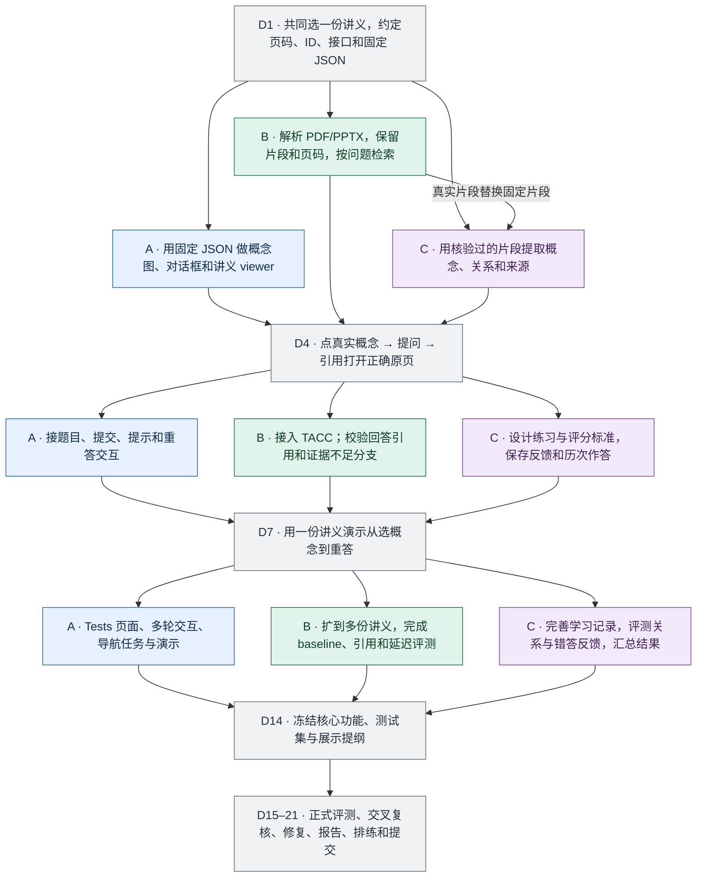

# 三个人如何并行开发 StudyGraph

按[三周分工表](../StudyGraph_三周计划与分工.docx)安排。蓝色 **A** 负责学生看见和操作的界面，绿色 **B** 负责讲义证据、检索与模型调用，紫色 **C** 负责概念关系、练习与反馈。灰色节点是共同验收点。各角色从 D1 商定的同一份样例开始。

| 交接方向 | 以“带宽上限”为例 | 接收方如何验收 |
|---|---|---|
| B → C、A | 提供文档 `roofline`、片段 `roofline-p2`、页码 2 和原文 | C 能给概念挂上证据；A 能打开同一份讲义的第 2 页 |
| C → A、B | 提供概念 `bandwidth`、关系两端的概念 ID、来源片段 ID 和推断标记 | A 能画出关系；B 能从选中的概念找到候选片段 |
| A ↔ B | A 通过 `POST /api/ask` 传会话、问题及可选概念；B 返回回答、证据状态和引用列表 | 有依据时能跳页，超出讲义范围时能说明证据不足 |
| A ↔ C | A 取题并提交作答；C 返回反馈、作答 ID 和尝试次数 | 重答沿用题目和会话 ID，前一次错答可追溯 |
| C ↔ B | C 提供目标概念、片段和评分标准；B 提供共用的模型调用入口 | C 可先用固定输出开发；接入真实模型后用同一组错答检查反馈 |

**开会时决定**：填上 A/B/C 姓名，选定第一份讲义，约好 D4 与 D7 的联调时间。每人提交自己的测试、报告段落和 slides，交叉核验标注。第三周由 A 展示问答与引用，B 讲架构和 TACC，C 展示错答反馈并讲评测局限。接口字段见[接口约定](interfaces.md)，会议步骤见[开工会议程](kickoff.md)。
